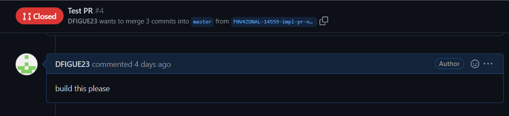
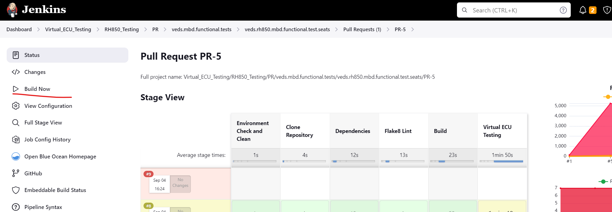

# Description
PATA (Perimet Antitheft Alarm) - RH850 Functional Test Scripts for Model Based Development
This repo contain scripts for RH850 Functional Testing for Model Based Development (MBD)

This repo is for testing the PATA feature -
The Perimeter Alarm feature will activate an alarm when any trigger input indicates that unauthorized access has occurred. Any door getting ajar, trailer getting disconnected or intrusion/inclination detection act as trigger inputs.

### High Level Design (HLD)
https://www.eesewiki.ford.com/display/fnv4/Perimeter+Anti-Theft+Alarm+HLD#PerimeterAntiTheftAlarmHLD-HLDRequirements

### Development repo
https://github.ford.com/FNV4-FordOS/FNV4-Horn-PerimeterAlarm-Sounder

### Test repo
https://github.ford.com/FNV4-FordOS-Test/veds.rh850.mbd.functional.test.horn_peri_sound

### Test Plan
https://fnv4-sw-testrail.ford.com/index.php?/suites/view/72844

# Setup [Build MBD component for RH850]
```
# Generate test binary for latest MBD component conan package 
make clean
make BUILD_TYPE=Debug SW_MODULE_NAME=[MBD conan package] SW_MODEL_FILE=[MBD model (ARXML) file] build VERBOSE=1

# To generate annotated source files along with Coverage Summary, run below command to generate test binary for latest MBD conan package
make configure LOCAL_CONAN=1
make clean
make BUILD_TYPE=Debug SW_MODULE_NAME=[MBD conan package] SW_MODEL_FILE=[MBD model (ARXML) file] build VERBOSE=1 LOCAL_CONAN=1

# To remove previously generated coverage report run below command
make clean_coverage

To generate a test binary for a *specific* MBD component conan package version create a conan.lock file
poetry run conan lock create --requires {name of specific package version}

Example: 
poetry run conan lock create --requires fnv4-trailer-swc-trailerlighting/0.1.0+228.g11e7dc7.fnv4zonal.26744

Note: Delete the conan.lock file once you are done with testing to switch back to latest version 
```

### Environment
## 1. Run Tests on local
Slash Environment is implemented to execute the VLAB testing in order to use APIs that trace the test cases defined
within the test managers and trace them to testrail.

Besides using the make command it is also possible to execute individual tests using the slash command for debugging 
purposes if needed, it will be needed to start a console at the root of the folder.

Slash environment documentation: https://slash.readthedocs.io/en/master/index.html

**NOTE: For running the slash environment should be run within the docker as special libraries are used for it.**

```
# Run simulation
make BUILD_TYPE=Debug test

# Launch docker
make BUILD_TYPE=Debug run_tgt_docker
# within docker / activate vlab
. scripts/activate-vlab2
# within docker / deactivate vlab
. scripts/deactivate-vlab

# Run *specific* tests
make BUILD_TYPE=Debug test TEST_FILTER='test_xxx'

Example: 
# Run all test starting with *specific* string test_moveseatautomatic
make BUILD_TYPE=Debug test TEST_FILTER='test_moveseatautomatic'

# Run all test and generate annotation files[files.html, functions.html and annotations folder]
make BUILD_TYPE=Debug test COVERAGE=1

# Run all test starting with *specific* string test_moveseatautomatic and generate annotation files[files.html, functions.html and annotations folder]
make BUILD_TYPE=Debug test TEST_FILTER='test_moveseatautomatic' COVERAGE=1

# Run test on Release Mode
make BUILD_TYPE=Release test TEST_FILTER='test_xxx'

# Debugging in vlab-ide 
make BUILD_TYPE=Debug test-ide TEST_FILTER='test_xxx'

# Note: test-ide is not supported in BUILD_TYPE=Release
```

Reference:

[VEDS Framework](https://github.ford.com/FNV4-FordOS/veds.framework)

## Slash

Examples for listing test cases<br>

```sh 
# within docker
root@docker-desktop:/home/dev/tests# slash list tests
Fixtures
Tests
tests/rh850_test_mgrs/tests_baremetal_rh850.py:TestsBaremetalRh850.test_placeholder_test
tests/rh850_test_mgrs/tests_baremetal_rh850.py:TestsBaremetalRh850.test_simulation_run_rh850
```

Example for running just a specific test(Make sure to activate the respective vlab environment first):<br>

Using the -k option it is possible to define a filter so just the tests that match this string will run .

[Slash documentation] (https://slash.readthedocs.io/en/master/slash_run.html#including-and-excluding-tests)

```sh 

### Output Logs

root@docker-desktop:/home/dev# source scripts/activate-vlab2
root@docker-desktop:/home/dev# slash -vvv run tests/rh850_test_mgrs/ -k placeholder_test
[2023-08-08 16:57:00.015737] DEBUG: slash.loader: Checking tests/rh850_test_mgrs/__init__.py
[2023-08-08 16:57:00.033554] DEBUG: slash.loader: Checking tests/rh850_test_mgrs/tests_baremetal_rh850.py
[2023-08-08 16:57:00.047154] DEBUG: slash.loader: Checking tests/rh850_test_mgrs/tests_barmetal_rh850_generic_base.py
1 tests collected   
tests/rh850_test_mgrs/tests_baremetal_rh850.py [2023-08-08 16:57:01.822252] DEBUG: slash.runner: Started test #1: <Runnable test <tests/rh850_test_mgrs/tests_baremetal_rh850.py:TestsBaremetalRh850.test_placeholder_test>>
.  PASS
==================== Session ended. 1 successful, 0 skipped, 0 failed, 0 erroneous. Total duration: 00:00:00 =========================
```

## 2. CI/CD Configuration to run test on Jenkin
Organizational Jenkins pipeline is used to trigger the builds the file [.aasrjenkbot](.aasrjenkbot) contains the bot library used to trigger the build.

In order to run the framework some configuration is needed for each project at the file of [mbd_cicd_conf.json](mbd_cicd_conf.json) which is a JSON used by the CI/CD environment to know which version of the conan packages, name of the binary and hash to use for the build. 

Each project to be tested needs to be a separate element and have a configuration as follows:

Example:

```json
{
    "PATA": {
        "SW_MODULE_NAME": "horn_perimeter_alarm",
        "SW_MODEL_FILE": "doc/PerimeterAlrmVehMdeNewTrgEvnt/PerimeterAlrmVehMdeNewTrgEvnt.arxml",
        "SW_COMPONENTS": "PerimeterAlrmVehMdeNewTrgEvnt",
        "script_to_use": "run-rh850-sim",
        "conan_lock_refs": [],
        "testrail_enable": true,
        "TESTRAIL": {
            "project_name": "Zonal Program",
            "milestone_name": "Non-Release Platform Capabilities and Components(Master)",
            "submilestone_name": "FunctionalTesting",
            "testplan_name": "MBD_PATA_CCZM",
            "description": "NB runs for Non Release",
            "test_suite_name": "Platform_HornAlarmSounderService",
            "test_section_ids": "450465",
            "automation_status": "Completed"
        }
    }
}
```

| Key | Description |  
|--   |--  |
| SW_MODULE_NAME  | Name of the MBD conan package to be downloaded, if multiple packages are needed for a composition they just have to be added separated by a comma. |
| SW_MODEL_FILE | MBD model (ARXML) file path to use for generation of the stubs |
| script_to_use | Script to use from the "scripts" folder to run the tests. |
| conan_lock_refs | If a specific version is needed for a specific package, these can be listed on here in a format that follows [conan package terminology](https://docs.conan.io/en/1.43/cheatsheet.html#package-terminology), also note that this applies for the [veds.framework](https://github.ford.com/FNV4-FordOS/veds.framework) as well since now it is also treated as a package and published as `fnv4-veds`, so if a specific version is needed, it has to be specified as well.|
| testrail_enable | Set to `true` to enable the upload of results into test rail, otherwise set to false, note that this only affects the NB pipeline. | 
| TESTRAIL["project_name"] | Name of the project in testrail to use for uploading the results. |
| TESTRAIL["milestone_name"] | Generic `Milestone`` name to use for uploading the results, the CI/CD looks for the milestone that matches this string and uses that as reference | 
| TESTRAIL["submilestone_name"] | `Submilestone` name in testrail to use for uploading the results, works the same as "milestone_name", leave empty string to ignore.  |
| TESTRAIL["testplan_name"] | Must be set to exact name of the `Test Plan` in testrail to use. |
| TESTRAIL["description"] | Description to put in the testrun in testrail. |
| TESTRAIL["test_suite_name"] | Must be set to exact name of the `Test Suite` name in testrail to use. |
| TESTRAIL["test_section_ids"] | Comma separated test sections to use, this is used to filter out the test cases that should be run. |
| TESTRAIL["automation_status"] | Maps to testrail `Automation` value in the testcase, this is used to just run the testcases that have this specified Automation value, valid values are `Completed`, `Production Ready`, `In Progress`. |


For more information on where the find the different required parameters for testrail check the following wiki https://www.eesewiki.ford.com/display/FNV4DEV/Where+to+Find+TestRail+Information+Used+by+Jenkins+Jobs#WheretoFindTestRailInformationUsedbyJenkinsJobs-TestCase

### Pipeline status 

**PR Build Pipeline**  
https://dev-jenkins-autosar.apps.pd108.caas.gcp.ford.com/job/Virtual_ECU_Testing/job/RH850_Testing/job/PR/job/PR_veds.mbd.functional.tests/job/veds.rh850.mbd.functional.test.seats/view/change-requests/

**NB Build Status**  
[](https://dev-jenkins-autosar.apps.pd108.caas.gcp.ford.com/job/Virtual_ECU_Testing/job/RH850_Testing/job/NB/job/NB_veds.mbd.functional.tests/job/veds.rh850.mbd.functional.test.seats/job/master/)

### Trigger PR pipeline
In order to trigger the PR pipeline in case that there is a failure within Jenkins, there are two options.

1. Type `build this please` as a comment in the Github PR.

2. Click on the `Build now` for the PR pipeline.


### Repository Structure
```
.
├── conanfile.py
├── config
├── docs
├── imgs
├── Makefile
├── mbd_cicd_conf.json       # Contains jenkin configuration
├── mbd_fw_manifest.xml
├── models      
├── poetry.lock              # File that use in building test binary 
├── pyproject.toml           
├── README.md
├── requirements.in          # File that lists all your Python dependencies
├── requirements.txt         # This file is autogenerated by pip-compile requirements.in
├── rh850                    # Contains tests scripts
├── scripts                  # Contain docker run scripts
├── sonar-project.properties # This file contains what folder will be monitored by sonar
├── tests                    # Contains the automated tests files to run scripts
└── tox.ini
```

### Owners
Organization
- Merkulov, Andrei AMERKULO@ford.com
- Nnacho, Joseph JNNACHO@ford.com
- Imam, Sikder SIMAM5@ford.com
- Mani, Vishnu Prakash  vmani2@ford.com
- Ghai, Shweta sghai@ford.com
- Jaganmohan,Kiruthiga KJAGANMO@ford.com

Test Team
- Rathore, Utkarsh urathor1@ford.com

Development Team
- Disale, Sandeep sdisale@ford.com
